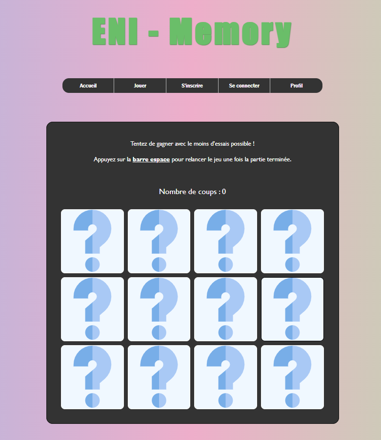

# ENI - Memory, premier projet web

## Description

Site web d'un jeu de Memory réalisé dans le cadre de ma formation à l'ENI, en suivant un cahier de charges.
Le joueur peut jouer à un memory avec le moins de coups possibles, il doit pouvoir gérer son profil utilisateur(changer photo de profil, pseudo, adresse-mail; changer le thème des tuiles de memory et sa taille).

**Fonctionnalités :**

- Plateau de 12 tuiles (6 paires), mélangées aléatoirement à chaque partie
- Compteur de coups joués et message de victoire
- Animation de retournement des tuiles
- Rejouer en appuyant sur la barre espace une fois la partie terminée
- Formulaires d'inscription et de connexion (validation HTML)
- Affichage adapté aux écrans mobiles (responsive)

## Statut du projet

**En cours de développement.**

- [x] Jeu fonctionnel
- [x] Pages et mise en forme
- [ ] Validation complète du formulaire d'inscription
- [ ] Connexion et sauvegarde des comptes
- [ ] Sauvegarde des 5 meilleurs scores
- [ ] Choix du thème de cartes dans le profil

## Auteur

Hina - [venomina](https://github.com/venomina)
