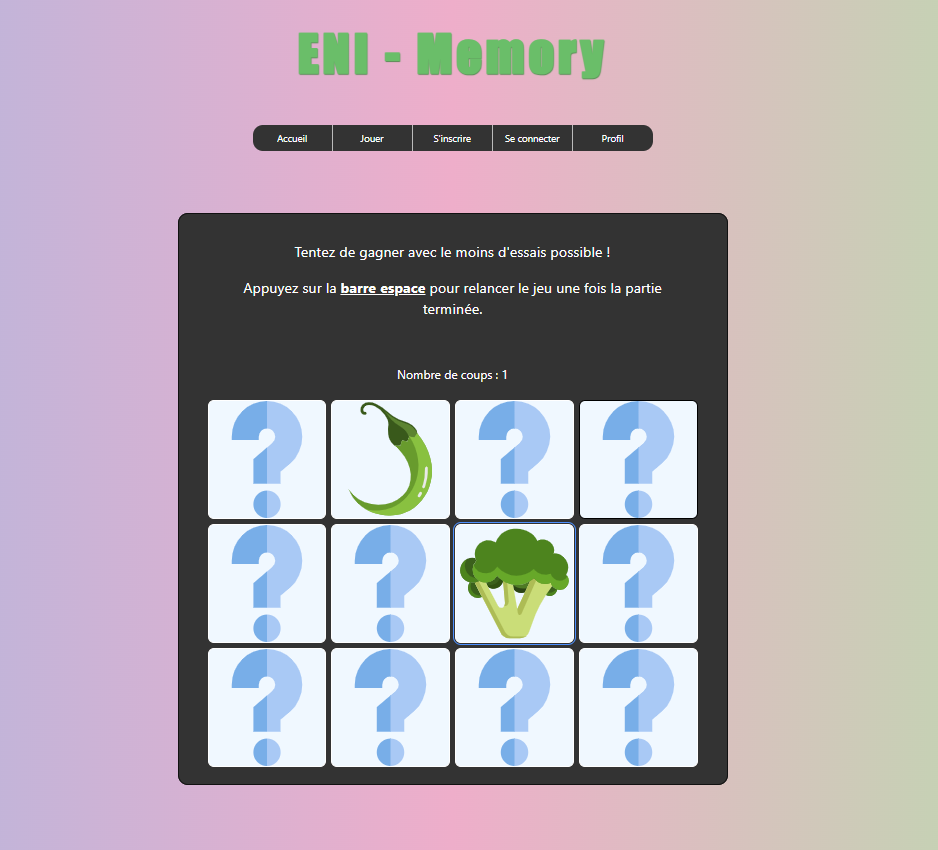
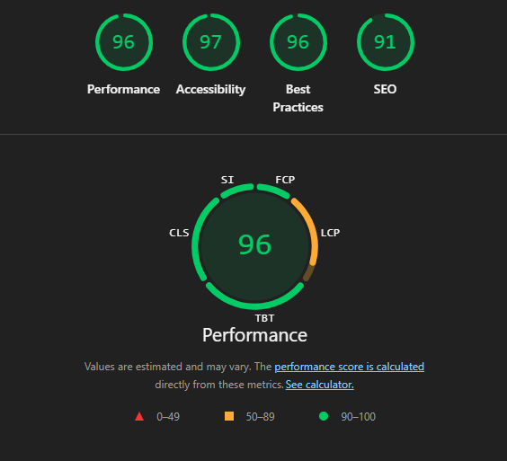

# ENI - Memory, premier projet web (16/11/2026 au 20/11/2026)

## Description

Site web d'un jeu de Memory réalisé dans le cadre de ma formation à l'ENI, en suivant un cahier des charges.

Le joueur retourne les tuiles deux par deux pour retrouver les paires, avec le moins de coups possible. À terme, il pourra gérer son profil : changer sa photo, son pseudo et son adresse mail, ainsi que le thème et le nombre de tuiles du Memory.

**Fonctionnalités actuellement présentes :**

** Jeu (`play.html` et `memory.js`)**

## Jeu (`play.html` et `memory.js`)

- Plateau de 12 tuiles (6 paires), mélangées aléatoirement à chaque partie
- Compteur de coups joués et message de victoire
- Animation de retournement des tuiles
- Rejouer en appuyant sur la barre espace une fois la partie terminée
- Formulaires d'inscription et de connexion (validation HTML)
- Affichage adapté aux écrans mobiles (responsive)

** Inscription (`inscription.html` et `inscription.js`)**

## Inscription (`inscription.html` et `inscription.js`)

- Formulaire avec champs nom d'utilisateur, adresse e-mail, mot de passe et confirmation du mot de passe.
- Indication visuelle de la force du mot de passe (faible, moyen ou fort).
- Réinitialisation de l'indicateur de force lorsque le formulaire est réinitialisé.

**À noter :** le script actuel calcule uniquement un indicateur de force.
Il ne valide pas encore les champs, ne vérifie pas la confirmation du mot
de passe et ne crée pas de compte. De plus, l'attribut `novalidate` du
formulaire désactive la validation native du navigateur.


## Statut du projet

**En cours de développement.**

- [x] Jeu fonctionnel
- [x] Pages et mise en forme
- [x] Indicateur de force du mot de passe
- [x] Validation complète du formulaire d'inscription
- [ ] Connexion et sauvegarde des comptes
- [ ] Sauvegarde des 5 meilleurs scores
- [ ] Choix du thème et du nombre de tuiles dans le profil

**Objectif :** obtenir un site complet où le joueur peut créer un compte, retrouver son profil et conserver ses meilleurs scores.

## Environnement de développement

- Un navigateur récent (Chrome, Firefox, Edge)
- Un éditeur de code ([VS Code](https://code.visualstudio.com/))
- [Git](https://git-scm.com/) pour cloner le dépôt

Aucune installation de dépendances n'est nécessaire (ni framework, ni Node.js).

## Guide d'utilisation



### Jouer

**Règles du jeu :**

1. Allez sur la page **Jouer**.
2. Cliquez sur deux tuiles : si les images sont identiques, elles restent visibles.
3. Sinon, elles se retournent face cachée.
4. La partie se termine quand toutes les paires sont trouvées.
5. Appuyez sur la barre espace pour relancer une partie.

### Fonctions principales

### Fonctions (`memory.js`)

| Fonction                          | Rôle                                                              | Retourne                  |
| --------------------------------- | ----------------------------------------------------------------- | ------------------------- |
| `mixGrid(tabFaces)`               | Mélange les images du tableau                                     | Rien (modifie le tableau) |
| `updateAttempts()`                | Met à jour l'affichage du nombre de coups                         | Rien                      |
| `updateTileLabel(index, faceSrc)` | Met à jour le nom accessible (`aria-label`) du bouton d'une tuile | Rien                      |
| `tileFlip(img, newImg)`           | Retourne une tuile avec une animation de 200 ms                   | Rien                      |
| `gameReset()`                     | Remet le jeu à zéro et remélange les tuiles                       | Rien                      |
| Écouteur `click`                  | Gère le coup : retourne la tuile, compare la paire                | Rien                      |
| Écouteur `keydown`                | Relance une partie avec la barre espace après une victoire        | Rien                      |

### Fonctions (`inscription.js`)

| Fonction / élément                 | Rôle                                                                   | Retourne                                        |
| ---------------------------------- | ---------------------------------------------------------------------- | ----------------------------------------------- |
| `setState(input, isGood, message)` | Applique l'état d'un champ (valide, invalide ou neutre) et son message | Rien                                            |
| `validateName()`                   | Vérifie le nom d'utilisateur (3 caractères minimum)                    | `true` si valide, sinon `false`                 |
| `validateMail()`                   | Vérifie le format de l'adresse e-mail                                  | `true` si valide, sinon `false`                 |
| `validatePassword()`               | Vérifie le mot de passe (6 caractères, un chiffre, un symbole)         | `true` si valide, sinon `false`                 |
| `validatePasswordConfirm()`        | Vérifie que la confirmation est identique au mot de passe              | `true` si valide, sinon `false`                 |
| `getStrength(value)`               | Estime la force du mot de passe (longueur, chiffre, symbole)           | Une chaîne : `"faible"`, `"moyen"` ou `"fort"`. |
| `updateStrength()`                 | Met à jour le niveau (`data-level`) et le texte sous le champ          | Rien                                            |
| Écouteurs `input`                  | Valident chaque champ pendant la saisie                                | Rien                                            |
| Écouteur `submit`                  | Valide tous les champs et bloque l'envoi s'il reste une erreur         | Rien                                            |
| Écouteur `reset`                   | Efface l'état des champs et l'indicateur lors de la réinitialisation   | Rien                                            |

### Pages du site

| Page         | Fichier            | Contenu                                             |
| ------------ | ------------------ | --------------------------------------------------- |
| Accueil      | `accueil.html`     | Présentation et règles du jeu                       |
| Jouer        | `play.html`        | Plateau de jeu                                      |
| S'inscrire   | `inscription.html` | Création du compte                                  |
| Se connecter | `signin.html`      | Connexion                                           |
| Profil       | `profile.html`     | Infos du joueur, choix du thème et nombre de tuiles |

## Technologies utilisées

- [HTML5](https://developer.mozilla.org/fr/docs/Web/HTML)
- [CSS3](https://developer.mozilla.org/fr/docs/Web/CSS)
- [JavaScript](https://developer.mozilla.org/fr/docs/Web/JavaScript)
- [Git](https://git-scm.com/) et [GitHub](https://github.com/)

## Structure du projet

```
ENI-Memory-Hina/
├── accueil.html        # Présentation et règles du jeu
├── play.html           # Plateau de jeu
├── inscription.html    # Formulaire d'inscription
├── signin.html         # Formulaire de connexion
├── profile.html        # Profil, choix du thème et du nombre de tuiles
├── memory.css          # Feuille de style commune
├── memory.js           # Logique du jeu et animation
├── inscription.js      # Validation de l'inscription
└── ressources/         # Images (tuiles, icônes...)
```

## Roadmap

| Étape   | Objectif                                        | Statut   |
| ------- | ----------------------------------------------- | -------- |
| ✅ v0.1 | Jeu fonctionnel et pages du site                | Terminé  |
| 🔄 v0.2 | Validation complète du formulaire d'inscription | En cours |
| ⏳ v0.3 | Connexion et sauvegarde des comptes             | À faire  |
| ⏳ v0.4 | Sauvegarde des 5 meilleurs scores               | À faire  |
| ⏳ v0.5 | Choix du thème et du nombre de tuiles           | À faire  |

## Bugs connus

| Bug                                                               | Statut   |
| ----------------------------------------------------------------- | -------- |
| Le formulaire d'inscription ne valide pas encore les champs en JS | En cours |
| La connexion et le profil sont des maquettes                      | Prévu    |

## Accessibilité et audits Lighthouse

Des audits Lighthouse ont été réalisés sur les versions ordinateur et mobile
du site. Les deux versions présentent les mêmes résultats :

| Indicateur       | Ordinateur |  Mobile |
| ---------------- | ---------: | ------: |
| Performance      |    100/100 | 100/100 |
| Accessibilité    |     98/100 |  98/100 |
| Bonnes pratiques |     96/100 |  96/100 |
| SEO              |     90/100 |  90/100 |

Attention, un audit Lighthouse automatisé ne garantit pas à lui seul une accessibilité complète.



## FAQ

**Comment rejouer ?**
Appuyez sur la barre espace une fois la partie terminée.

**Peut-on changer le thème des tuiles ?**
Pas encore, mais c'est prévu dans la roadmap.

**Pourquoi s'inscrire ?**
S'inscrire sert à conserver ses scores (fonctionnalité à venir).

## Auteur

Hina - [venomina](https://github.com/venomina)
